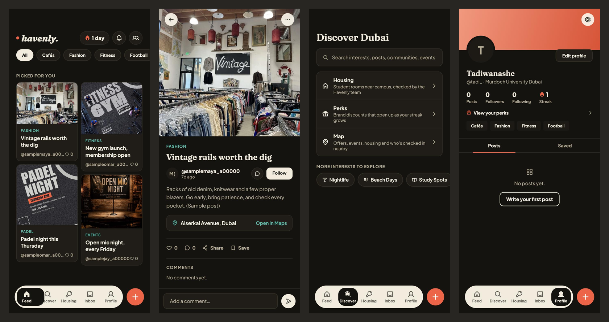

# Havenly

A Lemon8-style lifestyle community app for students & young adults in Dubai.



*Feed, post detail, Discover and profile from the web build running locally. The posts shown are labelled sample posts; no real members' content appears.*

## What it does
- **Feed** of visual posts with editorial "Havenly Picks", **Discover** (trending spots, campus events) and a map.
- **Communities** by interest and by university, with join and leave.
- **Real-time direct messages** and group chats (Supabase Realtime), with block and report tools.
- **Student housing:** listings, enquiries, admin notifications and a referral pipeline.
- **Safety and trust:** account deletion that removes chat traces and uploads, draft privacy policy and terms, crash reporting, and an adversarial review that closed five security holes.

## By the numbers
About 13,900 lines of TypeScript, 162 commits, a Supabase back end with 58 migrations, 28 tables and 122 row-level security policies. iOS, Android and web from one codebase.

Note: `app.json` holds the Supabase **anon** key and a Mapbox **public** token. Both are meant to ship inside the app; data access is protected by row-level security, never by hiding these keys.

## Stack
- React Native + Expo (iOS + Android from one codebase)
- Supabase — Postgres, Auth, Storage, Realtime (powers DMs)
- React Navigation — bottom tabs + native stack

**Read PROJECT_BRIEF.md first** — it's the full concept doc, feature list,
design system, and build priority order in one place.

## Getting started
```bash
npm install
```
1. Create a Supabase project at supabase.com
2. Run `supabase/schema.sql` then `supabase/seed.sql` in the Supabase SQL editor
3. In Supabase → Authentication → Providers → Email, turn **off** "Confirm email"
   for the closed-beta phase (turn it back on before public launch)
4. Copy your Project URL + anon key into `app.json` → `expo.extra`
5. Create the editorial system account (needed before running the editorial
   posts migration, which looks it up by email):
   ```bash
   curl -X POST "https://<project-ref>.supabase.co/auth/v1/admin/users" \
     -H "apikey: <service_role_key>" -H "Authorization: Bearer <service_role_key>" \
     -H "Content-Type: application/json" \
     -d '{"email":"editorial@havenly.app","password":"<any-strong-random-string>","email_confirm":true}'
   ```
   Nobody ever logs in as this account — the password just needs to exist.
   `supabase/migrations/20260912160509_seed_editorial_posts.sql` finds it by
   email, sets its display name/bio, and attaches the editorial posts to it.
6. Grant yourself (or whoever should manage events) admin access, so
   Settings → Create event shows up:
   ```sql
   update profiles set is_admin = true where id = (select id from auth.users where email = '<your-email>');
   ```
7. `npx expo start`

## Priority order
1. ~~Authentication (sign up/login/session)~~ — done: `src/lib/AuthContext.tsx`,
   `LoginScreen`, `SignUpScreen`; `RootNavigator` routes signed-out → auth,
   signed-in-not-onboarded → Onboarding, signed-in-onboarded → MainTabs
2. ~~Finish stubbed screens (Discover, Profile, PostDetail, CreatePost)~~ —
   done. Along the way also added `follows` (Profile stats + PostDetail
   Follow button), `toggle_post_like` RPC (Like actually persists and stays
   in sync now), and the `post-images` Storage bucket (real image upload in
   CreatePost). Comment and Save show a "coming soon" alert — no comments or
   bookmarks table exists yet, so those are genuinely not built, not faked.
3. ~~Load real fonts (Fraunces / Plus Jakarta Sans / JetBrains Mono)~~ — done
4. ~~Safety layer UI~~ — done: block (actually enforced via RLS + the
   `is_blocked_between()` function — hides posts, blocks new/existing
   conversations both ways) and report, with a `BlockedUsersScreen` to
   undo blocks
5. ~~Message requests vs. accepted DMs~~ — done: conversations start
   'pending', the recipient must accept before they can send anything
   (enforced in RLS, not just the UI); real unread tracking too
   (`conversation_reads`)
6. ~~Seed 30-40 real editorial posts~~ — done: 32 posts across all 10
   interest tags, attributed to a real "Havenly Editorial" system account
7. ~~True masonry feed layout~~ — done: manual two-column layout with
   deterministic per-post image heights + greedy column balancing
   (`FeedScreen.tsx`), replacing FlatList's equal-height-row numColumns
8. ~~Comments + a "Saved" bookmarks feature~~ — done: `comments` table
   (with a trigger keeping `posts.comment_count` in sync) and
   `saved_posts`, both respecting the blocking rules. PostDetail has a
   real comment thread + input bar and a working Save toggle; Profile's
   Saved tab shows real data and grid cells are tappable now.

## Putting the website online (Vercel)

The app also runs as a website. The Vercel project is `havenly-app`
(public address: https://havenly-app-zeta.vercel.app).

**Automatic:** once the project is connected to this GitHub repo, every
change merged into `main` is built and published by Vercel using the
settings in `vercel.json` (`npm ci`, then `npm run build:web`, output in
`dist`). Pull requests get a private preview link.

**By hand (fallback):**

```bash
npm run build:web                       # builds dist/ and fixes the font/icon paths
cd dist
vercel link --yes --project havenly-app
printf '.env*\n.vercel\n' > .vercelignore
vercel deploy --prod --yes
```

Why `build:web` and not plain `expo export`: Vercel skips folders named
`node_modules`, which is where Expo puts the fonts and icons, so
`scripts/fix-web-assets.mjs` moves them to `assets/vendor`. The map only
works in the phone app; the website shows a short notice instead.
